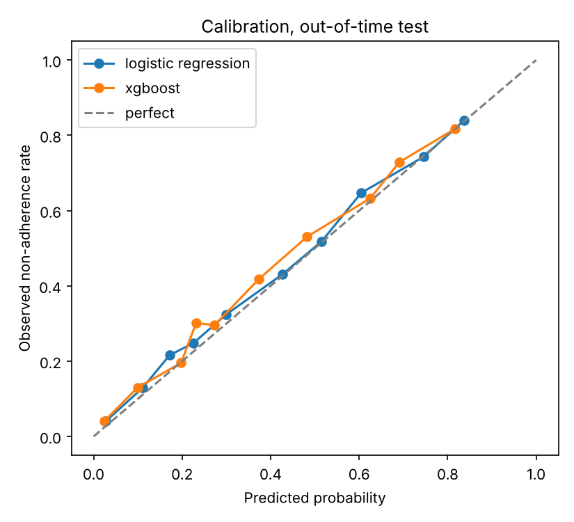
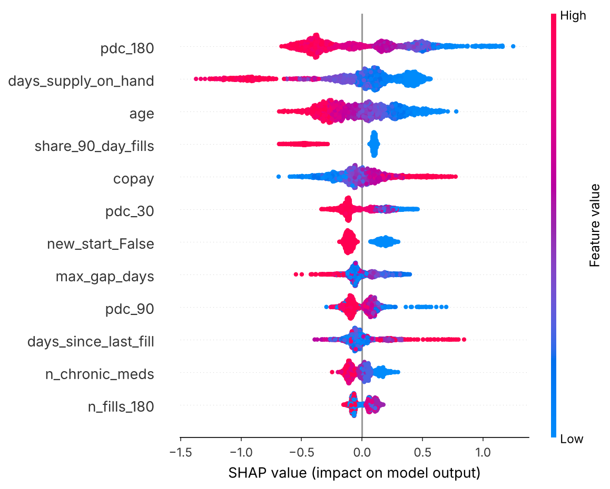

# Medication non-adherence prediction

Predicts which members on a chronic medication will fall below 80% proportion of days covered (PDC) over the next 180 days, early enough for a pharmacy outreach team to call them. It mirrors how this problem is approached in pharmacy benefit management: longitudinal refill features built in SQL, a temporal split, calibrated scores, recall at outreach capacity, and SHAP explanations.

> **All data here is synthetic.** `adherence.simulate` generates 20,000 members and 253,204 pharmacy claims from documented, seeded rules. No real patient, pharmacy or employer data is used. The numbers below show the pipeline working on that simulation; they are not a claim about real-world performance.

## The data

Each synthetic member has an age, sex, plan (commercial, Medicare or Medicaid), copay, mail-order status, number of chronic medications, a drug class (statin, metformin, ACE inhibitor/ARB or SSRI) and whether they are a new start. A hidden adherence propensity drives how often each refill is on time. 30% of members have a **disruption** at a random point (a life event, side effects or a cost change) after which refills turn irregular. Spotting that shift early from recent refill behaviour is the core of the task. The hidden propensity is never used as a feature.

## Features (SQL + PDC)

[`sql/refill_features.sql`](sql/refill_features.sql) runs in DuckDB over the claims and a table of index dates. It uses window functions to compute, over the 180 days before each index date: fill counts, the share of 90-day fills, gaps between fills, late fills (overall and in the last 90 days), days since the last fill and supply on hand.

[`adherence/pdc.py`](src/adherence/pdc.py) computes PDC over 30, 90 and 180 days with the standard carry-forward rule: early refills shift forward instead of double-counting. `pdc_trend` (30-day minus 180-day PDC) captures recent decline.

**Label:** PDC < 0.8 over the 180 days after the index date (the PQA / CMS Star Ratings threshold).

## Split: out-of-time and out-of-member

| Split | Index day | Members | Rows | Non-adherent |
| --- | ---: | --- | ---: | ---: |
| Train | 200 | 70% of members | 13,919 | 34.6% |
| Calibration | 200 | 15% of members | 2,985 | 33.6% |
| Test | 380 | other 15% | 2,909 | 39.3% |

The test set is both later in time and made of members the model never saw, so it can't benefit from memorising a member or from future information.

## Results (synthetic test set)

The outreach team is assumed to have capacity to call 15% of members.

| Model | ROC-AUC | PR-AUC | Brier | Recall at 15% capacity |
| --- | ---: | ---: | ---: | ---: |
| Rule: lowest 90-day PDC first | 0.744 | 0.632 | 0.250 | 27.0% |
| Logistic regression (calibrated) | 0.796 | 0.695 | 0.178 | 30.5% |
| XGBoost (calibrated) | 0.799 | 0.698 | 0.178 | 30.2% |

Both models beat the simple "call whoever has the lowest recent PDC" rule. Gradient boosting and logistic regression perform about the same here, so the more interpretable model is a reasonable production choice. Isotonic calibration on held-out members turns class-weighted scores into usable probabilities.

**Stability across drug classes** (selected model):

| Drug class | Test rows | Non-adherent | ROC-AUC | PR-AUC |
| --- | ---: | ---: | ---: | ---: |
| ace_arb | 744 | 37.0% | 0.806 | 0.691 |
| metformin | 712 | 40.6% | 0.808 | 0.720 |
| ssri | 288 | 46.5% | 0.785 | 0.748 |
| statin | 1,165 | 38.1% | 0.791 | 0.675 |



## What drives the score (SHAP)



Long-run PDC and supply on hand lead, followed by age, the share of 90-day fills, copay and recent PDC. That matches how the simulator was built, which is the point: the pipeline recovers known drivers without seeing the hidden propensity.

## Run it

```bash
pip install -r requirements.txt
make train   # simulate claims, build features, train, write reports/ (about 2 minutes)
make test
```

## Layout

```
src/adherence/simulate.py    seeded synthetic claims generator
sql/refill_features.sql      refill-behaviour features (DuckDB window functions)
src/adherence/pdc.py         proportion of days covered with carry-forward
src/adherence/dataset.py     index dates, eligibility, labels
src/adherence/train.py       models, calibration, metrics, SHAP, reports
tests/                       PDC edge cases and leakage checks
```

## Next steps for real data

- Swap the simulator for a claims extract with the same schema (`member_id, fill_day, days_supply`).
- Add multi-drug PDC, prescriber and pharmacy features, and benefit changes.
- Measure the effect of outreach with a holdout, since the model ranks risk but doesn't show who responds to a call.
